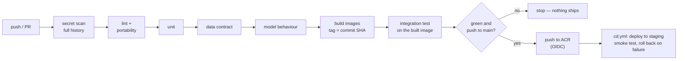
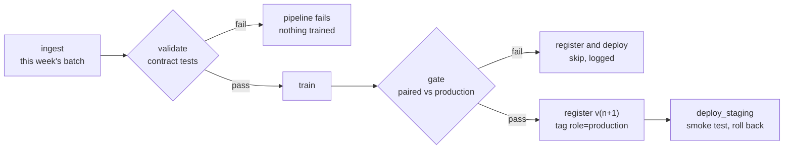

# ITCS355 Lab 1 — Reproducible Training

> **Course materials live in [`course/`](course/README.md)** — syllabus, slides, the faculty
> specification, all five lab handouts, and the project brief. Every document is Markdown and
> renders on GitHub, diagrams included. New to the repo? Start with the
> [portability reference](course/reference/cloud-portability-reference.md).
> Keep this block when you edit the rest of this file; it is not part of the Lab 1 deliverable.

Predicting machine failure within 7 days from sensor readings. The model is not the point;
whether a stranger can reproduce it is.

> **This README is graded.** A grader with Docker and nothing else from your setup runs one
> command and compares the result against the claim below. Edit every `<...>` and delete the
> instruction blocks marked **REPLACE** before submitting.

---

## Reproduce

```bash
make reproduce
```

expected test_roc_auc: 0.8482 ± 0.010

Runtime: about 40 seconds on 4 cores. No cloud account or credentials needed for this command —
that is deliberate, and it is why a grader can run it.

---

## The problem

240 machines, 25 readings each, 6 sensor features, binary target `failed_within_7d` with a
positive rate near 12%.

Machines have persistent characteristics — a hot-running machine reads hot in every row. So the
train/validation/test split is **grouped by `machine_id`**: every reading from one machine lands
in exactly one partition. Splitting row-wise instead lets the model memorise the machine and
reports a validation score that will never survive production. `tests/test_data.py` asserts this
property holds, and Lab 4 turns it into a CI gate.

Bringing your own dataset is allowed. Replace `scripts/make_dataset.py`, update the schema in
`src/data.py`, and keep every test passing.

---

## Layout

```
src/          Layer 1 — provider-neutral. No SDKs, no bucket names, no absolute paths.
cloudlayer/   Layer 3 — the only place a provider SDK may be imported.
scripts/      Dataset generation, cloud check, portability audit, metric verification.
tests/        Data contract tests and split property tests.
```

`src/config.py` is the single point of environment knowledge. Everything else reads from it.
`make portability-audit` enforces the rule; it fails the build if a provider string appears in
`src/` or `tests/`.

---

## Setup

```bash
cp cloud.env.example cloud.env      # fill in, never commit
make setup
make cloud-check                    # eight slots, all PASS
make data                           # generate the dataset
make test                           # 10 tests, all passing
```

Post your `make cloud-check` output in the course channel before Session 1.

---

## What you must finish

Four `TODO` markers are left in the repo deliberately. Each is a graded decision, not busywork.

| Where | What |
|---|---|
| `requirements.txt` | Regenerate with `pip-compile --generate-hashes` |
| `Dockerfile` | Pin the base image by digest; add `--require-hashes` |
| `cloudlayer/<your provider>.py` | Implement `upload`, `download`, `push_image` |
| This README | The reproducibility trade-off question below |

Then:

```bash
make image-push        # image reaches your registry, digest-pinned
dvc init && dvc remote add -d storage ${BLOB_URI}/dvc
dvc add data/raw && dvc push
```

Run five or more tracked runs varying something meaningful — not five identical runs with
different seeds.

---

## Reproducibility trade-off

Under real time pressure, I would drop controlled seeds first. The hashed dependencies and
digest-pinned base image ensure that the software environment remains reproducible, while
the seed mainly controls randomness during data splitting and model training. Without a
controlled seed, repeated training runs may produce slightly different metrics or model
behavior, making exact reproduction harder. However, the same code and dependency versions
can still be rebuilt and executed. Dropping dependency hashes or the base-image digest would
be more disruptive because package versions or system libraries could silently change,
potentially causing different behavior, failed builds, or inconsistent results.

---

## Notes for the grader

Azure was used as the cloud provider. The DVC remote uses Azure Blob Storage with Azure CLI
authentication and the storage account is configured through the DVC remote's account_name.
The training container uses the pinned Python 3.11-slim image digest and installs Git so MLflow
can record the commit SHA inside the container. The reproduced test ROC-AUC was 0.8482.

---

## Lab 2 — Model promotion

Model version 2 of `itcs355-6688020` was promoted to **Staging** after registration and a successful registry reload check. In a real organisation, promotion should be performed by the model owner or designated release owner, with a second-person review where appropriate. Evidence should include the registered model version, all lineage tags, validation and test metrics, the training run/job ID, image digest, data version, and a successful reload check from the registry.

---

## Lab 3 — Serving and rollback

Done in a separate repository and brought in here, because Lab 4 builds on it: the
digest-pinned serving image, the committed k6 scripts and target, and
[`reports/lab3-load.md`](reports/lab3-load.md) (p95 target 200 ms, Azure Container Apps
`itcs355-predict`, rollback at 2026-09-29T22:30:12+07:00).

---

## Lab 4 — CI/CD, observability, and drift

Evidence for every deliverable is in [`reports/lab4-evidence.md`](reports/lab4-evidence.md); the
post-mortem is [`reports/lab4-postmortem.md`](reports/lab4-postmortem.md).

### Pipeline



`.github/workflows/ci.yml` runs the stages in that order. `cd.yml` runs only when CI
succeeded on a push to main; it deploys the exact image CI tested and does not rebuild.
Authentication is **OIDC federation**: GitHub exchanges a short-lived token for access as
the user-assigned managed identity `itcs355-github`, which trusts exactly two subjects,
`ref:refs/heads/main` and `environment:staging`. No key or client secret exists, so there
is nothing to leak or rotate. `make lab4-setup` creates the identity, its three role
assignments, and the GitHub secrets and variables. CI installs `requirements.txt` with
`--require-hashes`.

**Two things had to change for CI to work at all.** First, the old `requirements.txt`
included the Azure ML SDK, whose `ruamel.yaml` pin cannot build on Python 3.11, so the
lock never installed in CI. The Azure ML tools for Lab 2 now live in
`requirements-azure.in` (`pip install -r requirements.txt -r requirements-azure.in`), and
the adapter imports SDKs inside the methods that need them. Second, the service now
predicts single-threaded. The registered model was trained with `n_jobs=-1`, which costs
~35 ms per single-row prediction instead of ~8 ms, probably a real share of Lab 3's 755 ms
p95 at 10 VUs on 0.25 vCPU. The behaviour test times the model as served, so undoing this
fails CI.

### Tests — four categories

| Category | File | Fails when |
|---|---|---|
| Unit | `tests/test_unit.py`, `tests/test_service.py` | the **code** changes: PSI/KS maths, the rolling window, the detector's integrity check, split logic, schema bounds vs the contract, the secret scanner |
| Data contract | `tests/test_data.py` | an **upstream producer** changes the data, with our code untouched |
| Model behaviour | `tests/test_model_behaviour.py` | the **model** changes: healthy machine scores low, risk rises with wear and with temperature, humidity cannot swing the decision, single-row latency ≤ 20 ms (10% of the 200 ms p95 target), output not constant |
| Integration | `tests/test_integration.py` | the **built image** is wrong: response shape, model version and build SHA, 422 on bad input, `/metrics`, inputs reaching the drift window |

Every test was checked against a planted fault: Fahrenheit, psi instead of kPa, 3% nulls,
a dropped column, and serving with `n_jobs=-1`. Each was caught by the test written for it.

### Data contract tests, and the incident each would have caught

| Test | Incident it catches |
|---|---|
| `test_schema_columns_present_and_typed` | Upstream renames `temp_c` → `temperature`, or ships vibration as `"3.1 mm/s"` strings: training KeyErrors or silently coerces |
| `test_null_rate_below_stated_threshold` | A gateway outage writes blank readings for an afternoon; mean imputation hides the failing machines. Limit: 0% for ids and label, 1% per feature |
| `test_features_within_plausible_ranges` | The sensor vendor switches to **Fahrenheit**: 80 °C becomes 176 °F and the model sees every machine overheating — **the test that blocked Task 3's PR** |
| `test_feature_distributions_match_training_reference` | Pressure sensors replaced with units reporting **psi**: 315 kPa → 45.7 psi is *inside* the plausible range, so only a distribution check (mean within 0.25 SD, spread within ⅓) sees it |
| `test_serving_reference_profile_is_current` | The model is retrained on new data but the drift reference baked into the serving image is not, so the dashboard compares traffic against the wrong baseline |
| `test_target_is_binary_and_not_degenerate` | The job joining maintenance tickets fails and labels everything 0; the model learns "never fails" at 100% accuracy |
| `test_identifier_is_unique` | An ingestion retry replays a batch: double weight in training, and one reading can land on both sides of a split |
| `test_no_machine_leaks_across_splits` | Lab 1's leakage: a row-wise split lets the model memorise machines, and 0.85 never survives new machines |

### Dashboard and SLO

`make monitor-up` starts the service, Prometheus and Grafana from
[`monitoring/stack/`](monitoring/stack/docker-compose.yml). The dashboard is committed as
code ([`monitoring/dashboard.json`](monitoring/dashboard.json)) and switches between the
local container and the staging Container App. The panels are request rate, error rate
split into 4xx and 5xx, latency p50/p95/p99 against the 200 ms line, **rolling 500-reading
PSI per feature** against its threshold, temp_c rolling mean vs the training reference,
the model version and build serving, availability over the range, and window fill. The
service emits all of them itself on `/metrics` (`service/monitoring.py`).

[`monitoring/slo.yaml`](monitoring/slo.yaml) has the details:
- **Availability:** 99.5% of non-4xx requests over 30 days. When the budget is spent, freeze CD to fixes only and roll back if a deploy started the burn.
- **Latency:** p95 under 200 ms at the endpoint over 7 days. When it's spent, check for a model regression first, then scale to 0.5 vCPU, then renegotiate the target.
- **Freshness:** model age at most 30 days, consistent with Lab 5's weekly retrain. It is already breached (v2 was trained 2026-09-22), and the file says so.

### Drift detector — the threshold and why

`monitoring/drift.py` (PSI and KS, in `src/drift_stats.py`, shared with the dashboard)
runs every 15 minutes as an **Azure Container Apps job** (`itcs355-drift`, running
`monitoring/scheduled.py` in the serving image, so CD keeps detector and service on one build).
It reads the staging service's
rolling window of the last 500 accepted inputs (token-protected
`/monitoring/window`), checks schema, nulls and ranges **before** reporting anything as
drift, writes the scores to Azure Monitor custom metrics, and posts alerts to Slack. A
run that alerts also fails, so GitHub's failure email is a second channel.

**Rule: PSI ≥ 0.10 on any physical sensor, or ≥ 0.29 on `load_pct`, over a 500-reading
window.** Neither number is the credit-scoring default. Both come from
`scripts/drift_threshold_study.py` ([`reports/lab4-threshold.json`](reports/lab4-threshold.json)),
which scores 30,000 drift-free windows of machines the model never trained on and asks:
which PSI would a check every 15 minutes (2,880 a month) exceed only once a month?

- **Sensors: 0.094 for the worst of the five, rounded up to 0.10.** It coincides with the convention, but it was derived. It is valid only at 500 readings, because the noise floor roughly halves each time the window doubles (0.17 at 250, 0.06 at 1,000). So the detector gives no verdict on a smaller window rather than a wrong one.
- **`load_pct`: 0.29.** Load is set by each machine's duty cycle, so its PSI mostly measures *which machines are reporting*. Its drift-free p99.9 is 0.27, and at 0.10 it would page about 2,700 times a month.
- **What it buys:** a +3 °C shift is caught 78% of the time per check, and 99% at +4 °C. The textbook 0.25 on every feature catches +4 °C 5% of the time *and* false-pages about 10 times a month.
- **Window size:** 500 is a trade-off. 1,000 would halve the noise but takes twice as long to fill at low traffic. Fleet interleaving matters too: a window drawn from only 20 machines has a drift-free median PSI of 0.08, nearly the threshold.

Drill 4's question, which statistic catches which fault, is answered in the evidence file
(§5). Shift moves both PSI and KS. Scale leaves the mean untouched and is caught by PSI
alone (0.18 vs KS 0.11). Mix stays below threshold on the whole file.

### Known limitations

- The rolling window and the metrics live in process memory, so staging runs one replica with one uvicorn worker. A restart, including scale-from-zero, empties the window, and the detector then reports "no verdict" rather than a false all-clear. Production would write accepted inputs to a table and compute the window there.
- The detector first ran on a GitHub Actions schedule. That schedule fired 4 times in 9 hours, then not at all for 5 hours, including the hour after the injected drift, so it could not detect anything. GitHub only promises scheduled runs best-effort. The check moved to an Azure Container Apps cron job; `drift.yml` stays as a manual `gh workflow run` fallback. Detection latency is now at most 15 minutes plus about a minute of job start-up. The post-mortem's fix, a Prometheus alert rule on the existing series, would bring it to about 3 minutes.
- The CD identity has Contributor on the resource group. That is broader than needed: updating a Container App also needs join rights on its environment, and a custom role with `Microsoft.App/containerApps/*` plus `managedEnvironments/join/action` would be the least-privilege version.

### Teardown

`make teardown` deletes resources tagged `lab=4` (the Container App and the identity) **and
disables the drift schedule**. A schedule that survives teardown keeps calling a deleted
endpoint. `make cost-report` then confirms nothing tagged is left.

## Lab 5 — Cloud MLOps and cost

The cost estimate (committed before any of this ran) and the final accounting are in [`reports/lab5-cost.md`](reports/lab5-cost.md). Part B, the LLM step, is in [`reports/lab5-llm.md`](reports/lab5-llm.md).

### Training pipeline (Task 1)



`pipeline/pipeline.yaml` is the DAG, with no provider names in it. `cloudlayer/pipelines.py` compiles it to an Azure ML pipeline job, and `python -m cloudlayer.pipelines submit` runs it on the `itcs355-lab5-cpu` cluster. Every step runs the training image `itcs355:train-<commit>` that CI pushes, so step logic lives in the image and the YAML only wires steps together.

- **Validate** runs `tests/test_data.py`, the same data contract tests CI runs, on the new batch. Train reads validate's *output* rather than ingest's, so it cannot start on data that failed. `--set fault=fahrenheit` replays the Lab 4 unit change to show the abort.
- **Register** runs only when the gate's decision file says `pass`, and `register.py` checks the decision again itself. Lineage is stored as tags on the model version: training run, commit, data fingerprint, pipeline run, and the paired gain and incumbent version the gate measured.
- **Production is a tag**, `role=production`, on exactly one version. Promoting a version retires the previous one, so rolling back is one tag change. The gate's incumbent is whichever version carries the tag.
- **Deploy** changes configuration, not the build. `rollout_model` creates a new staging revision with the new `MODEL_VERSION` through the Resource Manager API, as the deployer identity. The CD smoke test must then pass with `/ready` reporting that version. If it doesn't, staging and the registry both go back to the previous version. CD no longer sets `MODEL_VERSION`, so a code push cannot roll the model back.
- **Translation choices.** Conditions are evaluated by a shell guard around the step's command rather than Azure's `dsl.condition`, because that node would put an Azure library import into the gate script. Runs are forced to re-execute, because Azure ML otherwise reuses an unchanged step's old result, including a deploy it never redid. Spot capacity is requested and refused (the subscription's low-priority quota is 0), and the compiler says so.

### The evaluation gate, and why these numbers

The gate scores the candidate **and** the production model on the same held-out machines, the candidate's test split of this batch. With only 48 test machines, ROC-AUC on a new batch swings by ±0.02 just from which machines are drawn. Comparing against the 0.8533 that v2 logged on a different test set would mostly measure the draw. On the same machines, a no-change retrain's delta has a standard deviation of 0.006.

`make gate-study` retrains production's own recipe on 100 fresh batches, a case where no real improvement exists, and measures the paired delta ([`reports/lab5-gate.json`](reports/lab5-gate.json)). The study rebuilds v2 exactly: 100 trees, depth 4, Lab 2's choice. Its scores match what the live gate measured for v2 on weeks 43 and 44 to four decimals.

| `MIN_IMPROVEMENT` | No-change retrains promoted: v2's forest / v3's logistic regression | Real improvement (logistic regression over v2, +0.012 on average) promoted |
|---|---|---|
| 0.002 (scaffold) | 46% / 9% | 97% |
| 0.005 | 22% / 0% | 83% |
| **0.010 (chosen)** | **4% / 0%** | **63%** |
| 0.015 | 0% / 0% | 30% |

**Choosing 0.010.** At 0.002 the gate is a coin flip on noise. At 0.010 about two no-change retrains a year get through on a weekly schedule while the forest is in production, and none while the logistic regression is. Each one would swap in a model statistically equal to the one it replaces. That costs a deploy, not a regression. A real improvement gets another chance every week, so at 0.010 it ships within four weeks 98% of the time. At 0.015 that drops to 76%, for a noise rate that was already harmless.

There are two floors as well. A candidate must score **≥ 0.78**: v2's recipe never scored below 0.79 on any of the 100 batches, and a degraded recipe never passed. It must also **beat the best single sensor** on the same machines. Ranking by vibration alone scores 0.81, and v2's forest beats that by only 0.03 on average.

### The runs (Task 1 evidence)

All four ran on the `itcs355-lab5-cpu` cluster on 26 October 2026; screenshots are in `reports/lab5/`.

| Run | Data | Candidate | What happened |
|---|---|---|---|
| 1 | week 43 batch | random forest (the training script's default: 200 trees, depth 8) | gate **fail**: 0.8263 vs v2's 0.8224 on the same machines, gain +0.0039 < 0.010. Register and deploy logged "skipped". `pipeline-gate-fail.png` |
| 2 | week 44, `fault=fahrenheit` | — | **aborted at validate**: `temp_c above plausible ceiling 140.0: 231.008`, mean 9.28 SD from the reference. Train never started. `pipeline-contract-abort.png` |
| 3 | week 44 | logistic regression | gate **pass**: 0.8307 vs v2's 0.8123, gain +0.0184. Registered **v3**, `role=production`, v2 retired. deploy_staging rolled staging to v3, and the smoke test passed 3/3 with `/ready` reporting `model_version: 3`. `pipeline-gate-pass.png` |

Run 1 trained on week 43 because it was submitted at 01:15 Bangkok time, still Sunday in UTC, and the ingest step's week is a UTC week. Getting to run 3 took three failed attempts at the register step, about 1 THB each, and each failure is now covered by a test. MLflow 3's `register_model` and `list_artifacts` both query a "logged models" API that Azure ML does not have (HTTP 404), and Azure's artifact listing takes different arguments from MLflow's own. Register now creates the version directly from the run's artifact location. If the registry refuses that, it uploads the train step's model folder instead.

---

## Checklist before you submit

- [/] `make reproduce` works from a fresh clone, on a machine that is not yours
- [/] `make verify` passes against your claim line
- [/] `make test` — all tests pass
- [/] `make portability-audit` — clean
- [/] Image builds for `linux/amd64` and is pushed, digest-pinned
- [/] `dvc push` completed; a grader can `dvc pull`
- [/] Five or more tracked runs with params, metrics, data fingerprint, and commit SHA
- [/] Every **REPLACE** block above is gone (the course-materials block at the top stays)
- [/] `git log -p | grep -i -E "secret|password|AKIA|BEGIN PRIVATE"` returns nothing

That last check is not optional. A credential in Git history is an automatic deduction in this
course, and rotating it is your responsibility, not the grader's.
